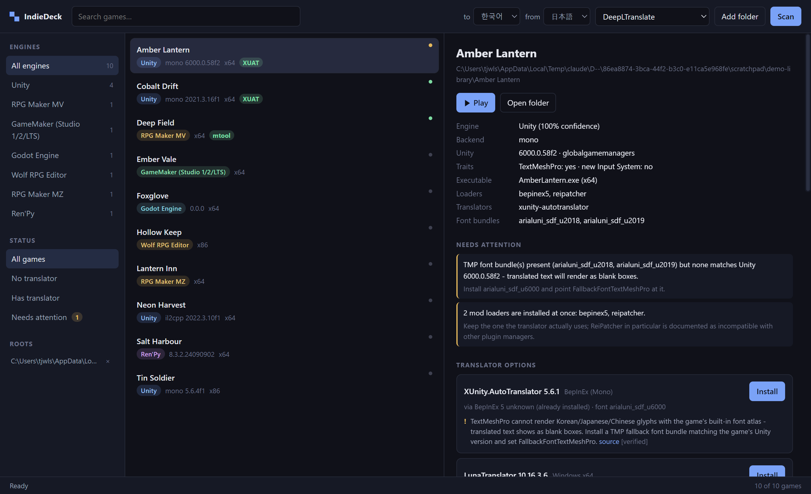
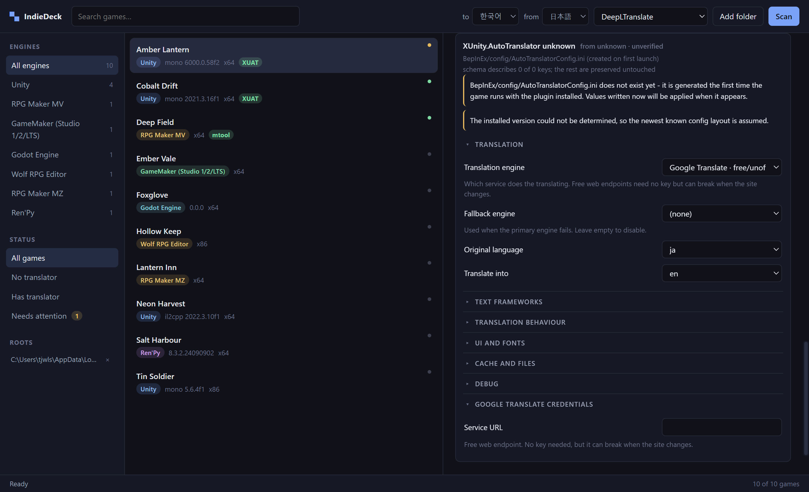

# IndieDeck

One launcher for a messy indie game folder: it classifies the engine, works out
**which translator build actually fits that specific game**, installs it with the
right mod loader, and manages mods per engine.



The hard part is not downloading XUnity.AutoTranslator. It is knowing that *this*
game is IL2CPP so the Mono package will never load, that the BepInEx 6 build has
to be a bleeding-edge one, that the ReiPatcher package disappeared from release
v5.6, that DeepL stopped working below 5.5.2, and that the TextMeshPro font atlas
you copied in was built for Unity 2018 while the game is Unity 2022 — which is
why the translated text renders as blank boxes. IndieDeck encodes those rules,
with sources, and applies them per game.

```
$ indiedeck scan D:\
Scanned 1 root(s) in 6.5s - 110 games found

By engine
  ID             ENGINE                      GAMES
  unity          Unity                          43
  rpgmaker-mz    RPG Maker MZ                   19
  renpy          Ren'Py                         19
  rpgmaker-mv    RPG Maker MV                   13
  godot          Godot Engine                    7
  unreal         Unreal Engine                   3
  ...
  translator installed: 45  mod loader installed: 14  unity mono/il2cpp: 26/17
```

## What it does

**Engine classification.** 17 engines via a declarative, scored signature
registry — Unity (with Mono/IL2CPP backend, exact engine version, TextMeshPro and
new-Input-System detection), Ren'Py, RPG Maker MV/MZ/XP/VX/VX Ace, Wolf RPG,
Godot, GameMaker, Unreal, KiriKiri, NScripter, TyranoScript, LÖVE, NW.js,
Electron, Java, Flash. Architecture comes from the PE header, not from a folder
name.

**Translator install with real version management.** `plan` ranks every viable
(translator, variant, version, loader) combination and shows *why* each one is
blocked or preferred, each finding carrying a confidence level and a source URL.
`install` then downloads, extracts, writes the config, and records a receipt so
`uninstall` can put the folder back.

**Translator settings without hand-editing INI.** The config a translator reads
is described by a *versioned schema*: a stable id like `xunity.targetLanguage`
maps to whichever `(section, key)` the installed build actually uses, so the
form is not pinned to one version's layout. Editing preserves every comment,
every key IndieDeck does not describe, and the file's line endings; credentials
are redacted everywhere but the file itself. See
[docs/config-manager.md](docs/config-manager.md).

**Reinstall option comparison (v0.1.8 source).** Before replacing a Unity
translator, review current values beside the compatible replacement's registered
schema defaults. Existing configuration is kept; the reference column is not a
reset or automatic migration plan, and the schema does not describe every
upstream option or version-specific default. Missing keys, declared additions,
mapping moves and uncertain version evidence are distinguished. Primary and
fallback provider requirements are included without exposing their credentials.
The completed operation can reopen the pre-reinstall report. The form also
shows saved non-secret provider values and keeps save feedback visible. See the
[comparison and editing scope](docs/config-manager.md#comparing-options-before-a-reinstall-v018-source).

**Saved comparison records (v0.1.9 source).** The last successful reinstall's
comparison can be reviewed after restarting the launcher, from its own game
detail card even when the translator payload has been removed. Records show
when they were stored and can be deleted explicitly without changing the game
or its INI. The store retains the latest report for at most 20 games. It saves
only schema-allowed values: credentials, arbitrary text, directories and unknown
key names are omitted, and omitted values are labelled in the saved view.
Unavailable drives do not automatically delete records. Damaged or unsafe
history is preserved and blocks history writes rather than blocking game
maintenance. A failed history save leaves a labelled session-only report. See
[saved record scope](docs/config-manager.md#saved-comparison-records-v019-source).

**Security checks (v0.1.11 source).** Windows desktop installation and launch
actions use a separate Microsoft Defender process. Translator/font downloads
are checked before use; game ZIP imports check both the source archive and the
unpublished extracted stage. Each game launch checks its executable, and MTool
handoffs check the tool and selected game executable. Switching a managed game
version checks its directory before changing the active pointer. A manual folder
scan and an explicit security-intelligence update are available in the security UI,
with cancellation and status recovery after a renderer reload. A completed
no-detection result is scoped to the inspected bytes and engine state.

Unavailable engines, stale intelligence, incomplete checks and ambiguous native
results stop these desktop actions. The first provider supports standard
Windows layouts, with default scan limits of 20,000 files, 20 GiB and 15 minutes.
The seven-day intelligence-age cutoff is a launcher freshness policy.
Core/CLI scanner callbacks remain opt-in. Registered asset downloads also enforce
HTTPS, approved sources/redirects, transfer limits and ordinary cache files.
ZIP format limits are separate: a format-valid archive can still exceed the
desktop scanner's file-count or 20 GiB scope and be stopped before publication.
Renderer permissions, remote requests, IPC senders and external links have
explicit main-owned boundaries. Games and external tools receive an environment
copy with named credentials and Node/Electron injection controls removed.
ZIP preflight rejects Windows path aliases, and copied mod/font inputs are bound
to the inspected bytes. The desktop runtime is Electron 43.8.7.

The launcher keeps the machine's existing Defender cloud and real-time policies;
the provider can use the network according to those settings. Malware Zero is
offered through its official site for separate manual use, with no embedded files
or database reuse. The launcher updater retains its fixed GitHub/SHA-512 flow and
does not gain a new antivirus gate. OS-wide firewalls, a game-execution sandbox
and guaranteed malware detection are outside this change. See
[security scope, sources and verification](docs/security-design.md).

Post-fix Korean/English source flows and local packaged ASAR security/history
checks passed on Electron 43.8.7. The IPC check accepts only the same pathname's
literal `~` and `%7E` spelling while preserving exact window/frame/document
authority. Source verification reported 532 tests: 530 passed, none failed and
two skipped, plus build and registry checks. The actual portable artifact also
passed normal and native 8.3 TEMP/TMP startup checks with exit zero and screenshots.
Exact-commit CI and public release remain separate checkpoints in
[the verification record](docs/security-design.md#verification-checkpoints).
The real native-engine evidence remains a separate unchanged 77-byte text
fixture; it does not establish game safety or public release completion.



**Korean and English throughout.** Not just the chrome: the compatibility
findings, the audit messages, the install steps and the config labels are all
translated, because those are the sentences that actually decide what a user
does. Every message carries its catalogue key, so switching language re-renders
what is on screen without re-running the resolver, and an untranslated key falls
back to English rather than to a blank. Adding a language is one file in
[`locales/`](locales).

**Mod management.** One model over BepInEx `plugins/`, MelonLoader `Mods/`,
GDWeave, UE4SS, RPG Maker `js/plugins` (including the `plugins.js` registry) and
Ren'Py `game/` — list, add, enable, disable, with the right disable strategy for
each host.

**A doctor for setups that silently do not work.** `check` sweeps the library for
TMP font bundles that do not match the game's Unity line, two mod loaders
installed at once, translator plugin files with no loader to load them, and
translator versions that predate a fix the chosen endpoint needs.

**Optional Unity TMP fonts.** For Korean, Japanese or Chinese targets, the
launcher shows a bundle recommendation based on detected TextMeshPro and Unity
version, with registered versus inferred compatibility clearly separated. A
translator plan can include or exclude the recommended font. An existing,
compatible XUnity installation can add just the font, or link an existing atlas,
without reinstalling the translator. Only `Behaviour.FallbackFontTextMeshPro`
is patched in that separate operation; other settings and comments are retained.
Recommendations are not proof of rendering in a particular game. Non-TMP and
unknown-version games do not get a forced TMP installation action.

**Game thumbnails.** The current source shows local cover images and can use
Steam's official artwork when an installed game's Steam ID can be identified.
The game detail page also offers explicit Steam title search and a user choice;
that search sends the title to Steam. IDs from a game's `steam_appid.txt` can
be development placeholders, so the image can still be for the wrong game.
The image cache is process memory, not an offline download. See
[docs/thumbnail-guide.md](docs/thumbnail-guide.md) for priorities and limits.

**Local MTool handoff.** The Windows launcher can connect an existing MTool
bundle for RPG Maker MV/MZ and XP/VX/VX Ace (RGSS), Wolf RPG, Ren'Py and
KiriKiri. It checks
`D:\MTool` by default, or a bundle folder selected in Settings. The game detail
card can open MTool with the detected game executable as one argument, open
MTool alone, locate the executable, and rescan the game after an external change.
This is not an MTool installer or proof of automatic game selection or working
translation: choose the languages and start translation in MTool, using its
manual drag/drop route if necessary. IndieDeck does not copy, download, update
or modify MTool's settings, library or activation files. Disconnecting only
disables the connection; it deletes nothing. Back up the game before using
MTool, and do not overlap its work with IndieDeck installs or mod changes.
External changes are outside IndieDeck's receipts and cannot be undone by its
Uninstall action. MTool markers in a Unity game can still be reported as
existing files; that does not enable the MTool handoff for Unity games.

## Install

### Windows app

On Windows 10 or 11 x64, download the current version from
[GitHub Releases](https://github.com/tjwlstj/indie-deck/releases/latest):

- **`IndieDeck-Setup-…-x64.exe`** — recommended. Installs per user, creates
  Start Menu and desktop shortcuts, and checks the stable GitHub Releases feed
  about eight seconds after startup if the update state is still idle. That
  check does not download anything or overwrite a check/download the user
  already started.
  **Settings → Launcher updates** lets you check again, explicitly download with
  visible progress, then confirm **Restart and install**. IndieDeck refuses that
  restart while a game-file change is pending or Windows is ending the session;
  it then opens the assisted NSIS update wizard and is configured to relaunch
  after the wizard finishes. This is not an unattended or install-on-exit update.
- **`IndieDeck-Portable-…-x64.exe`** — a single-file launcher that does not
  install. Portable builds are updated manually by replacing the executable;
  the settings card opens the fixed official latest-release page instead of
  invoking the native updater. Source-development and updater-disabled preview
  modes use the same release-page fallback.

The current Windows releases are not code-signed, so Windows SmartScreen may show an
"unknown publisher" warning. Verify the download against `SHA256SUMS.txt` on
the same release before running it. The project does not currently provide
32-bit or ARM64 Windows builds.

### Source and CLI

Requires Node 22.12+ (24+ recommended). No native dependencies.

```bash
git clone https://github.com/tjwlstj/indie-deck.git
cd indie-deck
npm install
npm run build
npm link --workspace packages/cli   # optional: puts `indiedeck` on PATH
```

Without `npm link`, run it as `node packages/cli/dist/index.js <command>`.

For the desktop launcher:

```bash
npm run desktop
```

The window is a thin shell over the same core the CLI uses - it renders the
library, the compatibility findings for the selected game, and installs with one
click. It runs with context isolation on and no node integration in the
renderer; the only bridge is a fixed list of IPC channels in
[`preload.cjs`](packages/desktop/preload.cjs). Install/removal progress stays attached to its game while you
open settings or select another game. The launcher shows the current stage,
download bytes and a collapsible log, then refreshes that game's badges,
statistics, detail and redacted config together. Reloading the renderer recovers
the active operation from main.

Unity XUnity.AutoTranslator now has a separate **Clean up existing translator**
and **Clean up and reinstall** preview. Only recognized component files are
eligible. The launcher retains exact pre-operation backups and install metadata,
preserves loaders, unrelated mods, configuration, translations and fonts, and
inherits a managed translator's original uninstall baseline. Reinstall uses a
compatible registered ZIP package and an existing BepInEx/MelonLoader host;
ReiPatcher, unknown files and unsafe ownership block automatic maintenance.
Scanning alone never deletes anything. This is bounded payload maintenance,
not universal loader replacement or durable crash recovery. Ordinary Install
continues to block overwriting an existing managed install record.

**Game archives and versions.** Choose a game archive in Settings or use the
archive-import entry point. Classic ZIP games can be validated and imported
into new side-by-side folders under the launcher data directory. The original
archive and older versions are never overwritten or removed. Imports record a
source SHA-256, optional user label and detected engine, then register the game
in the library. A filename version hint is explicitly a guess, not a measured
game version or Unity engine version. 7z and RAR are recognized but require
manual extraction; encrypted, split, ZIP64 and unsafe archives are rejected.
Current limits are a ZIP smaller than 4 GiB, at most 50,000 entries and 32 GiB
total unpacked bytes. Importing files does not execute or certify a game.

**Downloaded-game version management (v0.1.6).** An imported full ZIP
can start a new game product or, after confirmation, join an existing managed
game as another version. The first installation becomes active; later versions
stay inactive until **Use this version** is selected. Settings and each managed
game's detail page show the retained versions. Every physical copy remains in
the library, so choosing an active version does not hide or delete older games.
Saves, translator files, configuration and mods are not copied automatically;
a game can still use a shared save directory outside its installation.

The managed ZIP importer records a durable installation journal. After an app
restart it can retry library registration of a verified published copy, or report
an interrupted staging job while preserving the previous active version.
Recovery does not run a game or redownload it. Invalid ownership, unavailable
storage or damaged metadata require review instead of a guessed replacement.
This recovery scope is separate from process-local translator transactions.

Direct store downloads, additional archive formats and save migration remain planned in
[the store installation/update plan](docs/store-install-update-plan.md).
Steam artwork lookup does not establish purchase entitlement or manage a
Steam installation. Managed product/version support starts with v0.1.6.

**Store and browser connections (v0.1.7).** Settings can open
fixed official store, login, purchased-library and client-download pages in the
default browser. Selected official-client actions are generated from validated
product IDs. These actions report a handoff, not authenticated ownership or an
observed completed installation. Browser passwords, cookies and profiles are
not imported into IndieDeck.

The optional browser companion exports a small product-link JSON file after an
explicit click on a supported product page. Pick that file in Settings, review
it and optionally connect it to an existing managed game. The connection does
not transfer installation ownership or copy game files. Connected pages also
appear in that managed game's detail view. Loading the extension
in the user's browser is a separate manual step. Native Messaging and direct
itch.io OAuth/butlerd authentication remain planned; see
[browser/store integration](docs/browser-store-integration.md) for current
scope, browser differences and primary sources.

The offline `npm run desktop:flow` check exercises installation, settings
navigation, renderer reload, optional and standalone fonts, config/receipt
refresh, small-window sticky actions and ordered removal in Korean and English
using disposable game folders and mocked downloads. The font fixture is a real
7z archive containing synthetic bytes, not a working Unity atlas. ZIP flows
also cover explicit same-product confirmation, preserving the active
predecessor, choosing a new active version, reload persistence and reverting to
the older copy. Managed-installation unit fixtures cover registration failure,
source-independent recovery, atomic activation-save failure, storage identity,
disk-space rejection and owned-stage cleanup.
Translation-option flows also exercise read-only preview, game-specific saves,
provider boolean persistence, current-versus-reference reinstall review and
unchanged configuration bytes. Actual plugin migration and live translation
services are separate verification targets.
Launcher update controller and renderer tests use a mocked updater to cover explicit
check/download/restart states, busy and shutdown gates, retry and main-owned
reload recovery. The Korean and English desktop flows also boot an installed-
layout updater harness and drive the real main/preload/renderer events through
download progress, reload, a busy restart rejection, asynchronous failure and
retry. Its three native updater methods are mocked: those offline checks do not
contact the public feed or run a real NSIS updater. Packaging checks separately
verify the real installer, blockmap and feed metadata; a public update driven by
the new 0.1.3 UI still requires a later `0.1.3 → N+1` release pair.

Maintainers can find the versioning, tag, artifact, signing and updater procedure
in [docs/releasing.md](docs/releasing.md).

## Use

```bash
indiedeck root add "D:\"            # register a library root
indiedeck scan                      # classify everything under it
indiedeck list --engine unity --untranslated
indiedeck info "Amber Lantern"      # engine, backend, versions, what's installed

indiedeck plan "MyGame" --lang ko --from ja --endpoint DeepLTranslate
indiedeck install "MyGame" --lang ko --from ja
indiedeck uninstall "MyGame"        # removes exactly what it installed

indiedeck mods list "MyGame"
indiedeck mods add "MyGame" ./cool-mod.zip
indiedeck mods disable "MyGame" cool-mod

indiedeck config "MyGame"           # translator settings, by semantic id
indiedeck config "MyGame" --set xunity.targetLanguage=ko --dry-run
indiedeck config "MyGame" --providers   # engines, their tier and what they need

indiedeck check                     # library-wide health sweep
indiedeck --help --locale ko        # anything, in Korean
indiedeck registry check --online   # is the pinned data still current?
```

Every command takes `--json` for scripting, and nothing is written to a game
folder without a receipt. `install --dry-run` prints the exact plan first.

## How the compatibility engine works

A game's presence in the library comes from scanning registered folders, not a
hardcoded title list. Engine signatures, supported translators, provider
catalogues and compatibility weights are curated registry data. Recommendations
are deterministic profile-and-rule ranking, not an AI/LLM model or a learned
game-success database. Detection confidence is a heuristic signature score,
not the probability that a translator will work at runtime.

The verified v0.1.4 source separates executable candidates from known-engine
classification, fixes drive-root path boundaries and allows real game distribution
folders named `Windows`. Its settings depth, bounded/cancellable scan and save
contracts are described in [docs/game-discovery.md](docs/game-discovery.md), with
the primary-source Playnite/Lutris/Heroic comparison kept separate from IndieDeck's
design decisions. Local verification covers the automated suite and Korean/English
Electron scan/reload/cancel flows; distribution assets are tracked on the matching
[v0.1.4 release](https://github.com/tjwlstj/indie-deck/releases/tag/v0.1.4).
The outer walk's 20,000-directory
limit and engine scoring's 128-new-listing budget per engine are separate bounds,
not a total OS-read count. Missing registered roots preserve their prior rows,
and a post-save display failure is not reported as an unchanged library.
Existing saved depth values are retained;
unknown-engine executable-only imports and store-manifest integrations are outside
this change.

A scan produces a **game profile** (engine, backend, engine version, arch,
already-installed loaders/translators/font bundles). The resolver expands that
into candidate plans and runs the rules in [`registry/compat.json`](registry/compat.json)
over each one:

| severity | effect |
| --- | --- |
| `block` | candidate is removed — e.g. a Mono package on an IL2CPP game |
| `warn`  | kept, but scored down and surfaced to the user |
| `info`  | annotation only |
| `prefer`| score adjustment — reuse an installed loader, avoid bleeding-edge |

Rules carry `confidence` (`verified` / `inferred` / `community` / `unverified`)
and `sources`. An `unverified` rule — a widely repeated claim that upstream docs
do not actually state — can only ever warn, never block. An unknown engine
version never triggers a version gate; it downgrades to an advisory instead.

Some of the rules currently encoded:

- IL2CPP games need the `BepInEx-IL2CPP` or `MelonMod-IL2CPP` package; BepInEx 5
  cannot host them at all ([BepInEx docs](https://docs.bepinex.dev/articles/user_guide/installation/index.html)).
- XUnity.AutoTranslator's IL2CPP packages dropped pre-2017 Unity in 5.3.0, and
  5.4.0+ is built against BepInEx bleeding-edge build 704 or newer ([CHANGELOG](https://github.com/bbepis/XUnity.AutoTranslator/blob/master/CHANGELOG.md)).
- Release v5.6 ships no ReiPatcher asset, so that variant pins 5.6.1 or 5.5.2.
- DeepL below 5.5.2 sends legacy auth the current API rejects.
- New-Input-System games need 5.5.1+ or the in-game hotkeys do nothing.
- ReiPatcher is incompatible with any other plugin manager already installed.
- Korean/Japanese/Chinese on a TextMeshPro game needs a fallback font atlas built
  for that Unity line — see [`registry/fonts.json`](registry/fonts.json).

## The registry

Everything the resolver knows lives in plain JSON, separate from the code:

| file | contents |
| --- | --- |
| [`engines.json`](registry/engines.json) | scored detection signatures per engine |
| [`loaders.json`](registry/loaders.json) | mod loaders, their constraints, download assets, mod layouts |
| [`translators.json`](registry/translators.json) | translators, their variants and version tables |
| [`compat.json`](registry/compat.json) | the compatibility rules |
| [`fonts.json`](registry/fonts.json) | TMP font atlases mapped to Unity version ranges |

`indiedeck registry check` validates every cross-reference; `--online` compares
the pinned versions against upstream GitHub releases so staleness is visible
rather than silent.

## Tools it knows about

Installable: XUnity.AutoTranslator (all 7 packaging variants), BepInEx 5 /
BepInEx 6 Mono / BepInEx 6 IL2CPP, MelonLoader, MORT, LunaTranslator, Textractor,
GDWeave, UE4SS, renpy-translator, projz_renpy_translation, RPGMakerTranslator.

Not installable by IndieDeck, because they are closed source or distributed
outside its release-download path: MTool, Translator++, Unity Mod Manager.
IndieDeck detects their installed markers. MTool additionally has the explicit
desktop-only local handoff described above; it is not downloaded, copied or
managed as an installed component. Translator++ and Unity Mod Manager remain
detect-and-link-only.

## Design notes

- **No native dependencies.** ZIP extraction is a ~150-line reader over
  `node:zlib`; `.7z` (the TMP font archive) borrows an extractor already on the
  machine — 7-Zip if present, otherwise the bsdtar that ships with Windows 10+.
- **Never execute a third-party binary silently.** The ReiPatcher setup rewrites
  game assemblies, so it needs an explicit `--allow-run` and takes a snapshot of
  `Managed/` first.
- **Transactional writes.** Every write records whether it *created* a file or
  *displaced* one. Uninstall deletes the first kind and restores the second, so
  removing a mod can never take the game's own `plugins.js` with it. If a step
  fails mid-install the whole thing rolls back.
- **Downloads are streamed and hashed.** Nothing is cached until its hash is
  known, and a pinned checksum that does not match is discarded rather than
  installed.
- **The launcher's renderer is untrusted.** It addresses games and plans by
  opaque id; the main process resolves them against its own tables and rebuilds
  the privileged object itself.
- **Config edits preserve the file.** `AutoTranslatorConfig.ini` is documented
  inline by upstream; IndieDeck rewrites individual keys and leaves every comment,
  unknown key and line ending intact.
- **Extraction is path-safe.** Absolute paths and `..` traversal in archives are
  rejected before anything is written.

## Development

```bash
npm run build      # tsc --build across the workspace
npm test           # node:test, no test framework dependency
```

Sources are TypeScript with erasable-only syntax, so `node --experimental-strip-types`
runs them directly without a build step.

## Roadmap

Safety (transactional installs, download integrity, the desktop trust boundary),
the versioned config manager and Windows distribution are in place. Next up: a
game session layer, mod profiles and independently refreshable registry data.
See [docs/roadmap.md](docs/roadmap.md).

## Extending it

Adding an engine, a translator, a mod loader, a compatibility rule, a config
schema, a CLI command, a launcher panel or a language is a data edit in most
cases — and where it is not, the extension point is one entry in one table.
[docs/extending.md](docs/extending.md) walks through each one, including the
list of things that are still code and why.

`indiedeck registry check` is the guard rail: it rejects a misspelled rule
predicate, an unknown probe id, an engine and a translator that disagree about
each other, a mod layout that cannot work, and an unverified rule that tries to
block an install.

## Contributing

The most valuable contributions are registry entries: a compatibility rule you
had to learn the hard way, an engine signature that misfires, a translator that
should be listed. See [CONTRIBUTING.md](CONTRIBUTING.md) — a rule needs a source
and an honest confidence level, and that is most of the review.

## License

MIT. IndieDeck installs third-party software that carries its own licenses —
BepInEx (LGPL-2.1), XUnity.AutoTranslator (MIT), MelonLoader (Apache-2.0),
LunaTranslator and Textractor (GPL-3.0), MORT (MIT). It downloads them from their
official release channels and does not redistribute them.
